# OmniHub

A Windows companion for your PC: see what fills your drives in seconds, keep
notes and ideas for Claude, store passwords in a local encrypted vault (with
autofill in Brave, Chrome and Edge), boost the PC for games, mod your games,
host Minecraft servers around the clock, see what every program uses, and
use your phone to move files, control the music with synced lyrics, start a
game, run your servers or watch the PC's screen.

**[Download the latest release](https://github.com/Kerioxsx/omnihub/releases/latest)**
(Windows 10/11, 64-bit) · **[Website and tour](https://kerioxsx.github.io/omnihub/)**

Built from [`docs/PLAN.md`](docs/PLAN.md). Desktop app: Tauri 2 (Rust) +
React. Phone: a web app served by the PC itself — nothing to install from a
store, no cloud.

| | |
|---|---|
| **Storage** | Reads the NTFS Master File Table directly (the WizTree/Everything technique) and keeps it up to date from the USN change journal. Treemap, largest files, file types, search, cleanup suggestions, duplicates. Falls back to a parallel folder walk without admin rights or on FAT/exFAT/network drives. |
| **Apps** | Desktop programs, Store apps and Start menu entries with icons, size (from the latest scan), launch, uninstall, and the screenshots you took in each. |
| **Screenshots** | Region (frozen-screen overlay), screen, window, all screens; global hotkeys; a searchable library with tags, notes and favourites. Files stay normal PNG/JPEG files in *Pictures\OmniHub Screenshots*. |
| **Notes & ideas** | Markdown notes. "Ideas for Claude" are written as `.md` files (YAML front matter, optional JSON sidecar, an `INDEX.md`) into a folder you choose; the folder is watched so replies Claude writes there show up. |
| **Chats** | Talk to **Claude** and **ChatGPT's models** with your own API keys, and pick up your **Claude Code** and **Codex** conversations on this PC: read them, keep texting them (they run in their project folder with the permission mode you pick), or start new ones — from the PC or **from your phone**. Save any message as an **idea**, and see your **usage**: Claude Code's 5-hour window and tokens (with what they'd cost on the API), Codex's plan limits, and what your API keys spent. |
| **Vault** | Passwords, logins, Wi-Fi keys and secure notes, encrypted with Argon2id + AES-256-GCM and bound to your Windows account with DPAPI. Auto-lock, lock with Windows, Windows Hello unlock, clipboard that clears itself and stays out of clipboard history. Two-factor codes (TOTP), a password health report with an optional breach check, and **autofill in Brave, Chrome and Edge** through a small extension that talks only to the app on your PC. |
| **Tasks** | CPU, memory, **GPU**, video memory and disk use of every program, live, like Task Manager — with End task, priority and file location. Also on the phone. |
| **Games** | A boost profile per game (Fortnite, Roblox, VALORANT, CS2, Apex, Overwatch 2, Rocket League, League, GTA V, Call of Duty, Minecraft, Cyberpunk 2077 or any program), found on your PC from Epic, Steam, Riot, Roblox and Minecraft, in **Competitive**, **Quality** (never touches the game's graphics) or **Custom** mode: power plan, background junk closed, background apps at lower priority, a 0.5 ms timer, notifications, GPU choice, game priority, Wi-Fi low-latency mode and network priority — applied when you press Play and put back when the game closes. Max-FPS settings for seven games, the game's **NVIDIA driver profile**, an **FPS meter** (PresentMon: live FPS, 1% lows, stutters — also on the phone), **Optimize PC**, a ping helper with a lag-under-load test, and Roblox Fast Flag presets. |
| **My PC** | Your PC in 3D, built from its detected parts (processor, graphics card, memory sticks, motherboard, cooler, hubs) and your description of the case. **Lighting** for everything OpenRGB knows (static, breathing, spectrum, wave, flow, music, temperature; your own profiles), **fan profiles** Silent, Default (Auto) and Fast through LibreHardwareMonitor and liquidctl with safety floors, and **screens**: a case screen or a Kraken LCD showing your picture, GIF, video, live stats or the song. |
| **Mods** | A **mod manager** for every game in the Steam library (and Epic, and any game folder): how each game is modded (BepInEx, MelonLoader, Lovely + Steamodded, Script Hook V, .pak/UE4SS…), **Thunderstore** search and one-click installs with dependencies and the loader, mods from a file (zip, 7z, folder), on/off/update/remove with the game's files backed up, Steam Workshop items. **Minecraft modpack mixing** (Modrinth packs, .mrpack files or installed instances → one pack for one version and loader, saved as .mrpack or installed in the Minecraft Launcher), with a cover blended from the packs' icons, or painted from them by Pollinations with your own account. **Claude makes mods** with your Anthropic API key: it reads the game, writes the mod, and you install it with one click. |
| **Servers** | **Minecraft servers hosted on this PC, 24/7**: vanilla, Paper, Fabric, Quilt, Forge or NeoForge, made in one go (the right Java included), from a Modrinth modpack or one of your mixes (only the mods a server needs), started with OmniHub, restarted if they crash, backed up on a schedule. **Players** (whitelist, operators, bans, where each one is, their inventory: give, take away, teleport, heal), a **live map** drawn from the world's own files, the player limit and every setting, **mods, plugins and data packs** from Modrinth, **Claude making data packs and Paper plugins**, a console, and the way in for friends (firewall, router port, public address). **Who can join**: paid Minecraft accounts only, or **everyone, also without a paid account**, with your operators guarded. All of it from your phone too. |
| **Lights** | Every **Govee** light on the network (LAN Control), live: power, brightness, colours and whites, **screen sync** (each light takes its colours from its place around the screen, up to 30 times a second, eased), **music sync** (the album cover's colours, pulsing on the beats, spectrum or flow), effects, presets, timers and a sleep timer. With a Govee API key: each light's own scenes, music modes and settings (gradient, night light, a speaker's volume where it has one). |
| **Music** | What the PC plays (Spotify, Apple Music, browsers…). **Aurora**: the song's official music video (up to 4K, in step) or its full-size cover behind short lyrics in the cover's colours with sparing 3D emojis, or a music-reactive light show, a neon edge light, and lyrics word by word — full screen, on the Music page, or as a glow around your monitor over every app. Or the Apple Music–style **Lyrics** view. **Karaoke Studio**: sing along in any language with pronunciation written for your own, pitch feedback, and a mode where the song follows your voice. On your phone: cover, play/pause/skip/seek, volume, bass and treble (with Equalizer APO), and time-synced lyrics. |
| **Phone** | Pair by QR code or PIN. Volume of each app, mute the microphone and control calls (Discord, WhatsApp, Nyxen…), close or quit open apps. Browse shared folders, download with resume, upload big files with resume and checksums, receive files from the PC, lock/sleep/restart/shut down with a cancellable countdown, music with lyrics, tasks, start games with their boost, launch apps, jot ideas, read the vault (opt-in, HTTPS only), text Claude, ChatGPT, Claude Code and Codex, and run your Minecraft servers (players, inventories, the map, console). |
| **Screen sharing** | PC → phone in any browser (desktop duplication, adaptive JPEG stream, optional mouse/keyboard control, pause or share one window for privacy). For 4K60 it hands off to Sunshine + Moonlight; Android → PC uses scrcpy, and **iPhone → PC** uses AirPlay (a UxPlay add-on OmniHub downloads and checks for you). |

## New in 0.53.0

- **Vesper 0.5.0**: a launcher-style Client menu with a live 3D preview and animated tiles and drawer, a POV camera (distance, over-the-shoulder, F5 glide, freelook), damage numbers, a smooth hotbar, low-health and hit pulses, and horns that grow from the top of the head.

## New in 0.52.0

- Fix for "Couldn't load versions" when files.minecraftforge.net drops the connection: version lists retry, then use mirrors or Forge's Maven list.

## New in 0.51.0

- Forge installs fall back to retries, mirrors (BMCLAPI, Maven's second address) and the Windows proxy, every file still checked against Forge's checksums; Forge's installer reruns if it stops halfway.
- **Vesper 0.4.2**: Install a resource pack inside Minecraft in one click and it turns on straight away.

## New in 0.50.0

A UI polish pass on the app and the website: aligned page edges, no gradient text, stronger easing and press feedback, themed caret and controls, even heading wrap and tabular numbers.

## New in 0.49.0

- **Minecraft hub** (Play → Client): install any launcher or client (Minecraft Launcher, Prism, Modrinth App, CurseForge, ATLauncher, Lunar, Badlion, LabyMod, Feather, Vesper…), and **Forge, NeoForge, Fabric, Quilt or Legacy Fabric for any Minecraft version** as a launcher profile with its own folder, plus Modrinth mods for it.

## New in 0.48.0

- **Client tab** for Vesper Client (Play → Client) with one-click install and its requirements: Minecraft 1.8.9, **Forge 1.8.9-11.15.1.2318** (not Fabric / Legacy Fabric / NeoForge), Java 8, no other mods needed.
- **Vesper 0.4.2**: one-click Install for resource packs inside the game (turns them on). **0.4.1**: download Modrinth resource packs inside the game, an FPS boost that restores your settings when off, and redesigned Wraith horns (plus a crystal flame) and cars.
- **MIT licence** for the whole repository.

## New in 0.46.0

- **Vesper Client 0.3.0**: neon jump marks (six-point star and more) in your chosen world colour, world glyphs, rain that splashes plus puddles that mirror the sky, hit sounds, emotes with a wheel (including a car flex with original cars), a Wraith flame head with horns, speed blur, a neon block outline and a time changer.

## New in 0.45.0

- **Vesper Client 0.2.0**: four funny kill effects (Bonk!, Party Popper, Ghost Out, KA-POW!), full skies (3 new, daylight, moon, Milky Way, shooting stars, motes), menu and motion blur, FOV up to 150 with zoom, 8 swing and 4 block-hit styles, hit lines, and **live lyrics in your Minecraft world** from OmniHub (served on 127.0.0.1 only; can be turned off in Aurora's settings).

## New in 0.44.0

- **Aurora**: covers are sharp again (songs whose full-size cover was missed are looked up again, the match is more forgiving, nothing small is stretched across the screen, and the settings show each cover's size with *Look again*). **Spotify songs start right away** from Aurora's search and Up next, in the background, once you connect Spotify (your own Spotify developer app, Premium); plus **Play next** into Spotify's queue.

## New in 0.43.0

- **Play resolution** (Games → Extras): switch the whole PC to 4K, 1440p (2K), 1080p, 720p or stretched 4:3 — per game (switches at start, back at close) or with one click — so windowed fullscreen plays at it and alt-tab stays instant. The switch keeps your refresh rate and lets the graphics card scale, so the monitor doesn't black out to re-sync.

## New in 0.42.0

- **Vesper Client** (`client/`): an original Forge 1.8.9 PvP client mod with an animated title and menus, Blender-made cosmetics, five kill effects, a draggable HUD, a 3D showroom and FPS savers. Download `Vesper-Client-1.8.9.jar` from the release (needs Forge 1.8.9-11.15.1.2318) or install it from OmniHub's Minecraft page.

## New in 0.41.0

- **OmniHub Client for Minecraft 1.8.9**: Forge plus the best open-source PvP mods (hitboxes, crosshair, hit colour, 1.7 animations, FPS fixes, HUD, in-game resource pack browser) as a profile in the official Minecraft Launcher, and OmniHub's own kill-effects mod (source in `minecraft-mod/`).
- **Fortnite**: resolution, 3D resolution and frame cap recommended from your monitor and specs; display resolution setting; HDR off.

## New in 0.40.0

- **New layout**: sections (Workspace, Play, Connect) in a floating top bar and the section's pages in a slim rail; the classic sidebar is still in Settings → Appearance → Layout.

## New in 0.39.0

- **Find a setting** in Settings; **search** runs music, mute, timers, lights, smart home and other PCs; two more themes (Dangai, Sōkyoku Hill); add a whole folder to the photo gallery; Karaoke from Big Picture; a fix for emulator disc images in oddly named folders.

## New in 0.38.0

- **Big Picture Room tab**: music controls, lyrics, volume and light presets from the couch; rows that carry on into the next; it reopens on your last tab; clearer help for non-Xbox controllers in channels.

## New in 0.37.0

- **Themes**: four Bleach-inspired looks made of shapes and colour (Soul Society, Hueco Mundo, Karakura night, Senbonzakura), each with an optional picture of your own; a **photo gallery** for "Your photo" with timed changes, darken, blur and drift.

## New in 0.36.0

- **Redesign, step 1**: a floating sidebar with groups that fold, the same frosted glass on the sidebar, dialogs, search and messages (solid when Windows reduces transparency), and a search (Ctrl+K) that also finds games, channels, Settings sections, themes and Big Picture.

## New in 0.35.0

- **Your photo as the wallpaper** on the PC and the phone: it fills the screen, is sized for 4K (small photos enlarged and sharpened), and the theme's colours come from it.
- **Phone app**: frosted glass, Match PC or elegant palettes, a wallpaper (the PC's or your own), and a faster start.
- **Screen control**: touch by default, one-tap shortcuts, click buttons, hold & drag, and a scroll strip.
- **iPhone notifications on the PC** over Bluetooth (Apple's accessory notification service), with Windows pop-ups and dismiss.

## New in 0.34.0

- **Big Picture, redesigned**: Home, Library, Watch and Settings tabs on the bumpers, a "pick up where you left off" card, landscape rows, a cover grid with filters, four backgrounds and reduce motion.
- **Watch**: Continue watching (the series you're part way through on Netflix, Crunchyroll, Disney+, HBO Max, Prime Video, Paramount+, Apple TV and YouTube, read only from your browser's watch pages, on your PC), a browser you pick the first time (changeable in Settings), and the controller as the browser's remote until you press View.

## New in 0.33.0

- **Performance**: latency to the screen, a smart frame cap (NVIDIA), VRR for windowed games, paused background apps and core parking off while playing, standby memory, a heat report after each game, overlay and shader-cache checks, a repeatable benchmark, a mouse polling-rate test, stretched resolution per game, and Fortnite update and downtime alerts.
- **Emulators**: install and update from official GitHub releases (checksums checked), a BIOS checker (your own files), a DAT-based ROM organizer, saves and memory-card backup, controller setup, per-game fullscreen/shaders/options, cheats, RetroArch netplay, RetroAchievements, ROMs in the Library, and the phone as a controller.
- **More**: hide a whole folder in the vault, game deals across stores, control a second PC, a weekly report, and smart home (Home Assistant, Shelly) from scenes and the deck.

## New in 0.32.0

- **Timers, alarms and a bedtime lock** that ring on the PC and the phone, and **shut down or sleep when downloads finish**.
- **Slow down an app's internet**: cap a program's upload (Windows QoS; uploads only, administrator approval).
- **Soundboard** with keys that work in games, and **text shortcuts** that type saved text into the app in front.
- **Colour picker and ruler**, and a **screen translator** (Windows OCR + a local Ollama model, nothing leaves the PC).
- **Clip my eliminations in any game**: OCR on the middle of the screen saves an instant-replay clip.
- **Free game and patch notes alerts**, **PC checks** (drive health, stress test, ready to play), **pin any window on top**, **Wi-Fi QR for guests**.
- **Move a game to another drive** with a link left behind, **music per game** through scenes, a **Big Picture keyboard**, and an **aim trainer**.

## New in 0.31.0

- **Scenes**: one tap for lights, fans, notifications, Discord, sound, microphone, screen mode and HDR, also run by themselves when a game starts (and undone when it closes).
- **Every game store** in the library: GOG, Ubisoft Connect, EA, Battle.net and Xbox / Game Pass.
- **Night light** on a schedule, **local AI** (Ollama) in Chats, **Ask your PC** on Home.
- **Speedrun timer**, **crosshair overlay**, **desktop widgets** and a **live wallpaper**.
- **Go-live alerts** for Twitch and YouTube creators, a **daily recap** on the phone, **similar photos**, **limited guest phones** and a **synced folder** on the phone.

## New in 0.30.3

- **Karaoke Studio** (Music → Karaoke Studio): lyrics that light up word by word with pronunciation written for your first language and accent, Follow the song with pitch, steadiness, entrance and range feedback, and Follow my voice, where a song file from your PC waits for you and picks up where you stopped. Nothing you sing is recorded.

## New in 0.30.2

- **ZANGETSU v2**: Bankai, Hollow and Mugetsu reworked, plus the new **Hakka no Togame**: their own panels, backgrounds, transitions and sounds, and your own picture behind each mode (kept on your PC).
- **Button studio in 3D** in Big Picture: a live controller model, button remapping and colours.
- **Quick sites** (Netflix, YouTube, Crunchyroll, Disney+, HBO Max and more) in Big Picture and on the phone.
- **Phone**: Bluetooth (connect, disconnect, forget) and choosing where the sound comes out.

## New in 0.30.1

- **Controllers in Big Picture**: Xbox, Elite, PlayStation 4/5 and Edge, Switch Pro, Joy-Con, Switch 2, GameCube and any other gamepad, with their own button symbols, Nintendo layout, vibration, PlayStation light bar colours and a controllers panel.

## New in 0.30.0

- **Capri Desktop** (capriai.app): installed from its developer's GitHub releases, opened and closed from the PC, phone or deck, with Ollama set up for its local brain.
- **Quiet mode** every night on a schedule, or with a sleep timer; **overheat alerts** on the PC and phone.
- **Phone**: a live gaming dashboard (FPS, temperatures, ping), search of the PC's files, photo import, voice commands and the party queue.
- **Party queue**: friends add songs from their phones with a QR code.
- **Apps update themselves** at night (winget); **screen-time limits** for apps and websites.
- **Games → Extras**: sensitivity converter, Fortnite item-shop alerts and a PC parts price tracker.

## New in 0.29.1

- Game covers, backgrounds and logos load again. Steam's current art addresses are looked up, and games from other stores use the same game's cover on Steam.
- **Big Picture**: the library full screen for a controller, with animated backgrounds and covers (Library → Big Picture, or the View button).

## New in 0.29.0

- **Quiet mode** from the phone, the PC or a deck button: screens off and fans at their lowest safe speed while the PC stays on; it ends when you're back at the PC. A **Lowest** fan profile too.

## New in 0.28.0

- **Fortnite**: Competitive / Balanced / Pretty presets, FPS compared by settings, a replay cleaner, Wi-Fi power saving off, and a graphics driver check that suggests cleaning the shader caches after an update.
- **OBS buttons** on the deck and wheel, a **Discord status**, a **network monitor** (speed, data per day, online programs), **backups** to another drive, **controller mode** for the whole app, screenshots **searchable by their text**, and **wake & play** from the phone.

## New in 0.27.0

- **Updates always finish**: the installer no longer closes itself together with the app; if an update ever doesn't finish, OmniHub says so and offers to try again.
- **Bleach themes**: Bankai, Hollow and Mugetsu, switched from the sidebar, with condensed headings, angular accents and a slash on switching (drawn by OmniHub, no artwork from the series).

## New in 0.26.0

- **Quick actions**: a macro deck on the PC and the phone (media, mic, apps, games, keys, text, counters), a quick-launch wheel at the mouse (Alt+Shift+Q), and clipboard history with pictures and pins (Alt+Shift+V).
- **Focus sounds**: rain, waves, wind, a fireplace and noises, mixed, made on the fly.
- **Batteries** of the PC, controllers and Bluetooth devices, with history, time left and low-battery alerts.
- **PC health score** with a fix for each problem, and **Tidy Downloads** in one click.

## New in 0.25.0

- **Game library like the Steam Deck**: real cover art, a full-screen page per game with achievements, screenshots, soundtrack, players online, mods and save backups; controller navigation; a recap after each session; daily time limits.
- **Steam extras** with your own key: achievements, friends online, and wishlist sale alerts.
- **Emulators**: finds them, scans your ROMs with box art, and starts any game in the right one.
- **Counter events, phases, goals and undo**, hunt stats, a shiny celebration, controller buttons as keys, counters on your phone, and an **OBS overlay**.
- Fixed: counter keys that got stuck after a game grabbed the keyboard.

## New in 0.24.0

- **Counters**: count with keys that work from anywhere (even in a game), with pictures, timers, a pop-out window that stays on top, and history.
- **Shiny hunting** for all 1025 Pokémon with real odds (Masuda, Shiny Charm, any method's odds) and your finds kept.
- **Auto clicker**: any button, single or double, down to 0.01 ms (it shows the real speed), at a point or the mouse, with limits; F6 starts and stops, Esc always stops.
- **Pokémon save editor** for Ruby, Sapphire, Emerald, FireRed and LeafGreen: trainer, party and PC boxes, .pk3 in and out, checksums fixed, a copy kept on every save.
- **Glass** look: frosted cards and sidebar over any theme.

## New in 0.23.0

- **Forgot the vault password?** Windows Hello can set a new one with nothing lost; without Hello, set the vault aside (kept, not deleted) and start a new one, then put it back if the password comes back to you.
- **Minecraft theme**: blocky hills, clouds, a sky that follows your clock, the Minecraft font on headings, and your own item pack floating by like dropped items.
- **More animated themes**: Matrix, Rain, Snowfall, Fireflies, Lava lamp and Clouds (light).

## New in 0.22.1

- **Change master password**: from the vault's header or Settings → Vault; logins, hidden files, locked notes and Windows Hello keep working.
- **Animated themes**: Aurora, Synthwave, Ocean, Galaxy, Sakura and Ember, each with its own colours (Settings → Appearance). They pause when OmniHub isn't on screen and hold still with Reduce motion.

## New in 0.22.0

- **Scan with your phone**: pages, receipts and business cards are found, straightened and cleaned up on the phone, then saved on the PC as a PDF with their text (Windows' own OCR) or as a note; receipts and cards are read into fields, and cards become a .vcf contact.
- **Barcode to PC**: scan a code with the phone and type it where the PC's cursor is, copy it, or open its link.
- **Whiteboard**: draw on the phone, see it on the PC (Tools → Whiteboard), save it as a picture.
- **Approve on your phone**: vault passwords, restarting as administrator, shredding and PATH changes wait for a tap on your paired phone (optional).
- **Download on the PC**: send a link from the phone (or paste one in Tools → Downloads); files as they are, video pages through yt-dlp.
- **Images and Video tools**: remove location and camera details, resize, compress, HEIC → JPG; fit a video in 10 MB, compress, convert, cut, or keep only the sound.

## New in 0.21.0

- **Guest uploads**: a QR code anyone on your Wi-Fi scans to send you files from their browser (no pairing, only receives, ends by itself).
- **Folder rules**: move, copy or recycle files that land in a folder (only once they finish downloading; nothing overwritten).
- **Focus**: a focus timer that keeps chosen apps closed during rounds, and a time tracker (opt-in, local, program names and minutes only).
- **Developer tools**: Git projects dashboard, PATH and environment variable editor, phone QR codes for local dev servers.

## New in 0.20.0

- **Aurora music hub**: search songs, albums and artists from the player and play them in YouTube Music, Apple Music, Spotify (app or web), SoundCloud or Amazon Music (or whichever app is playing); artist cards with bio, Play/Shuffle, top songs and an album carousel; album track lists; **Up next** from the album and artist; a big clock. Catalogue: Deezer's public API; bios: Wikipedia.
- **Tools page**: checksum checker, secure shredder, bulk rename with preview, recent files, ports viewer with End, window layouts.
- **Command palette answers**: calculator, unit conversions, Base64, JSON, UUID, SHA hashes, Unix timestamps.
- **Panic button** (desktop, tray, phone, voice), **phone connect alerts**, **privacy dashboard** (mic, camera, location use).
- **Voice**: lock the PC, open apps, control music, mute, panic.
- **Phone**: PC screenshot, print on the PC, panic, home-screen shortcuts.

## New in 0.19.0

- **Clips & Capri** (Games → Clips & Capri): instant replay keeps the last minutes of your game on the graphics card; say **“Capri, clip that”**, **“Capri, record the last ten minutes”**, **“Capri, call me …”** and more. Capri reacts to your games, and follows Counter-Strike 2 and League of Legends matches (kills, rounds, wins), clipping big moments by herself.
- **Autofill in any browser**: pick one or several of Chrome, Edge, Brave, Opera, Opera GX, Vivaldi, Chromium and Firefox.

## New in 0.18.0

- **Hide any file, of any size**: Vault → **Hidden files**. Drop a zip (or anything) on the window: it's encrypted with your vault key and removed from where it was. Open a temporary copy, save a copy, or **Unhide** it back to its folder. **Lock any note** with the same password: the lock button in a note seals its text, and only the unlocked vault opens it.

## New in 0.17.0

- **Search everything** from Ctrl+K (files, notes, apps, screenshots, vault titles), **app updates** through winget, **pin a screenshot on top**, **Wi-Fi QR codes** in the vault, **imports from Bitwarden, Chrome, Firefox, 1Password, KeePass and CSV**, and on the phone: get the PC's clipboard and **Share → OmniHub** (Android).

## New in 0.16.1

- **Capri** switch at the top of Chats (and in the tray): installs [Capri](https://github.com/mochiiwuff/capri-desktop) from her official release the first time, starts her with OmniHub while on, and closes her when off.

## New in 0.16.0

- **Monitor brightness from your phone**: phone → More → Volume & brightness (and My PC → Monitors on the PC) has a brightness slider (and contrast) for every monitor and one for all of them, over DDC/CI like Twinkle Tray, which can keep running.

## New in 0.15.1

- **Roblox starts again**: Roblox now blocks shader tools, so OmniHub takes out the ReShade 0.15.0 put in its folder and no longer installs it. **No duplicate games** under *On this PC*.

## New in 0.15.0

- **A much lighter app**: windows you can't see (in the tray, minimised, or behind a full-screen game) stop drawing, give back their memory and sleep until you look again; pages load only when opened; "is it running?" checks no longer take a full process sample.
- **Games open again**: Roblox opens its app from Play, a slow game gets a hint and a **Start again** button, and a new **Free memory before the game** step gives the game the most free RAM.
- **Fortnite**: a one-click **Max FPS setup**, a **Rendering mode** choice (Performance, DirectX 12, DirectX 11 or keep yours) and **Clean Fortnite caches** (logs, crash reports, web cache and the graphics driver's shader caches). Plus everything from 0.14.0 below.

## New in 0.14.0

- **Roblox shaders** like RoShade and Bloxshade (official ReShade with Realistic, Vivid, Cinematic, Soft, Sharp and Custom looks, kept after Roblox updates), **every Roblox flag** searchable with each custom flag switched on or off, and Govee lights with segments (like the H6076) in full colour on Auto.

## New in 0.13.5

- **Govee**: *Per segment, any light* gives lights that ignore streaming (like the H6076 floor lamp) a colour per segment through Govee's own segment commands.

## New in 0.13.4

- **Govee**: lights that don't stream segments (like the H6076 floor lamp) get one colour in effects, music and screen, a calmer brightness boost, and SteelSeries GG (Prism) is spotted when it fights over the keyboard. Mixes have a **Save as .mrpack** button again.

## New in 0.13.3

- **NeoForge and Forge mixes install** straight into the Minecraft Launcher (OmniHub runs their installer). **Govee**: steadier lamps, more saturated colours, each light shows what it gets. **PC lighting**: *Like the Govee lights* for the keyboard and PC, a warning when another RGB program fights over the lights, and no more keyboard lag.

## New in 0.13.2

- **Govee lights**: lights with few LEDs show the screen's main colour instead of a pale white, Auto gives one colour to every light not known to stream segments (so every light updates), and a light that drops out of streaming comes back by itself.

## New in 0.13.1

- **Govee lights**: every light found (OmniHub also asks each address on the network), **Auto** per-segment or one-colour streaming so every light follows music and the screen, a **brightness boost** and truer screen colours, and smoother music on lamps with many LEDs. Installer fix for a remembered install folder on a drive that's gone.

## New in 0.13.0

- **Share mixes and modpacks with friends**: one file with every mod, the configs and the cover picture, optionally with your server in their list; open a friend's pack and it becomes a mix with their picture, ready to install. Modpack details (mods, updates on Modrinth, worlds), and **a server from a world you played alone**, with your single-player inventory moved to your account.

## New in 0.12.1

- **Your installed modpacks**: Mods → Minecraft lists the modpacks Prism Launcher (and PolyMC, MultiMC), CurseForge and the Modrinth App installed, with their version, loader, mods and when you last played. Mix any of them with other packs, or host one as a server in one click. Folders are only read; a launcher kept on another drive can be added.

## New in 0.12.0

- **Minecraft server hosting** (a new Servers tab): make a vanilla, Paper, Fabric, Quilt, Forge or NeoForge server, or one from a modpack or your mix, and keep it running 24/7 on this PC. Players with their location and inventory, the whitelist, the player limit, a live map, mods, plugins and data packs (also made by Claude), backups, and friends joining over the internet. **Players without a paid Minecraft account can join** if you choose: OmniHub then keeps your operators safe (an operator's name from a new place waits for your OK). Everything also works from the phone (More → Minecraft servers).

## New in 0.11.1

- **Covers for mixed Minecraft modpacks**: each mix gets a picture made from its packs' icons (every icon whole, on soft seams, pixel art kept crisp), used as its Minecraft Launcher profile icon. Or **AI blend**: Pollinations paints one new picture from them, with your own Pollinations account.

## New in 0.11.0

- **Chats**: Claude, ChatGPT, Claude Code and Codex in one place, also from your phone (a new Chats tab): every conversation on your PC, streamed answers, new chats in any project folder, ideas saved from any message, and usage (Claude Code's 5-hour window and tokens, Codex's plan limits, your API keys' spend).

## New in 0.10.0

- **Mods**: a mod manager for every game in your library (Thunderstore installs with dependencies and loaders, mods from files, on/off/update/remove with backups, Steam Workshop), a **Minecraft modpack mixer**, and **Claude making mods** for your games with your own Anthropic API key.

## New in 0.9.0

- **Lights**: every Govee light on your network, with **screen sync**, **music sync** (album cover colours and beats), effects, presets, timers and a sleep timer; with a Govee API key also each light's own scenes, music modes and settings, including a speaker's volume where a light has one.

## New in 0.8.1

- **More for Fortnite**: NVIDIA Reflex On + Boost, GPU crash debugging and latency markers off, and with Lowest quality also Nanite, Lumen and temporal anti-aliasing off (for DirectX 12).
- **More for Roblox**: the graphics slider at its lowest instead of Automatic, and *Lighting worked out once* (an allowlisted Fast Flag) in the Max FPS preset.
- **Memory speed check** in Optimize PC: says when a DDR5-6000 or DDR4-3600 kit runs slower because EXPO or XMP is off in the BIOS.

## New in 0.8.0

- **Play and Boost only work again**: the administrator prompt opens in front and the game never waits behind it.
- **My PC**: your PC in 3D from its detected parts, with **lighting** (OpenRGB: effects, music sync, profiles), **fan profiles** Silent / Default (Auto) / Fast (LibreHardwareMonitor, liquidctl) and **screens** (a case screen or a Kraken LCD with your picture, GIF, video, stats or song).
- **Fortnite and Competitive mode** also set the game's **NVIDIA driver profile** (maximum performance, low latency, no forced VSync or frame cap).
- **Lighter in the tray**: the web view drops caches, timers pause, and the music check slows down when nothing plays.

## New in 0.7.3

- **Music videos matched to the song by ear** (a story intro is skipped), **Spotify's Canvas and videos mirrored** from its window, glitch and echo on the sung word, colour flashes on drops, lyrics in time with the voice, and no more getting stuck in full screen.

## New in 0.7.2

- **Any emoji pack** in Aurora: a zip of pictures (PNG, GIF, WebP, JPG or SVG — Twemoji, Noto, OpenMoji, Discord emotes, game textures…) matched by code point, name, short code or the word itself, or an emoji font. Pixel art stays crisp. Your files stay on your PC.

## New in 0.7.1

- **Your own font and emoji pictures** in Aurora: choose a font file and a zip of item textures (a Minecraft look); words get the matching picture. They stay on your PC.
- **An emoji at least every two lines**, the **whole cover** again for everyone, clearer reasons when a **music video** can't play, and **faster releases**.

## New in 0.7.0

- **Music videos play**: through a relay page on OmniHub's website (YouTube refuses official videos inside apps), and directly with yt-dlp when an artist allows their video only on YouTube; the most watched official video wins.
- **Animated album covers** from Apple Music (up to 4K) behind the lyrics, and under the light show's effects.
- **The whole cover**, nothing cut off, sides blending into its own glow; remixes get their own cover; Deezer as a second cover source.
- **Lyrics for more songs**: NetEase as a second synced source; misses are retried.
- **Emojis in Spanish too**, more often, plain and in the lyrics' colour by default.
- **Simpler Aurora settings**: Quick choices first, the rest under More settings.

## New in 0.6.1

- **Smoother lyrics in Aurora**: sung words now fade and leave on their own (at most three at a time) instead of collecting, invisible, for a whole line — less work for the graphics card and no words piling up on slower PCs.

## New in 0.6.0

- **Aurora goes cinema**: the song's **official music video** fills the screen behind the lyrics (muted, up to 4K, kept in step with the song); else the artist's **animated cover**; else the **whole cover at full size** (the 3000×3000 original from Apple's catalogue, sharp on any monitor) drifting slowly; else the light show.
- **Short lyrics in the cover's colours**, with adaptive shadow and darkening so they stay readable on bright pictures, placed where the cover is calm.
- **3D emojis** (Microsoft Fluent Emoji) beside words you can picture or feel — sparingly, never on every line.
- **Corner light** in the cover's colours, and a *Background* section for all of it: what plays, music videos on/off, fill or whole picture, crop, video quality, cover motion, darkening, corner light, video timing.

## New in 0.5.1

- **Sharper covers**: the same cover at 1200×1200 from Apple's iTunes catalogue when it matches (players give Windows a small one), and crisp bicubic scaling for the rest.
- **14 effects** for the cover, each with its own slider (beat zoom, glow, echo, ripples, twist, shake, glitch, colour split, pixelate, fisheye, kaleidoscope, halftone, scanlines, duotone), with Calm, Default, Wild and Shuffle presets; glitch is now subtle by default.
- **Lyrics word by word for every song**: when the lyrics only time lines, the words are spread over each line by syllables (an estimate; can be turned off). Only the word being sung is highlighted.
- **Lyrics that move** with the music — bounce on beats, sway, pop in — with a Movement slider.

## New in 0.5.0

- **Aurora**, a new music view (the Apple Music–style **Lyrics** view stays; switch at the top left or with V):
  - the playing song's **cover art** as the visual, on black: it swells with the bass, glitches and splits on beats, with Visual, Fisheye, Fisheye Visual, Minimal and Ambient styles;
  - a thin **neon edge light** (edge, inner highlight, glow and bloom) in the cover's colours, pulsing with the music;
  - **lyrics, huge and floating**: one word at a time when the lyrics time words, else one line, with the next in a pill; instrumental breaks, songs without lyrics and instrumentals each handled;
  - follows the music through **WASAPI loopback** (what Windows plays — never the microphone, nothing recorded or sent), with sensitivity, bass, smoothing, reduced motion and no-flash settings;
  - a glass **settings panel** for every part, saved and with Reset to defaults;
  - optional **glow around your screen** over every app (each monitor or one), click-through, stepping aside for full-screen games.
- **Your own .lrc files** for lyrics (checked before LRCLIB, matched by tags or name and length).

## New in 0.4.0

- **Boost modes**: Competitive (most FPS, also the game's own graphics), Quality (nothing that changes the picture — 4K Ultra stays 4K Ultra) or Custom, per game.
- **Max-FPS settings for VALORANT, Counter-Strike 2, Apex Legends, Overwatch 2 and Roblox**, next to Fortnite and Minecraft, with **Optimize all** in Optimize PC.
- **Less delay while playing**: background junk closed (and sync apps reopened), browsers and launchers at lower priority, a 0.5 ms timer, no power throttling for the game.
- **FPS meter** with live FPS, 1% lows and stutters, on the PC and the phone, and results to compare boosts.
- **Lag under load** test with a grade and advice; a precise timer, no network throttling and no Sticky Keys pop-up in Optimize PC.

## New in 0.3.0

- **Fortnite at max FPS**: unlimited frame rate, Performance mode, lowest settings, VSync off and the FPS counter, written into Fortnite's own settings (yours kept to put back), before every launch.
- **Optimize PC**: full monitor refresh rate, Ultimate Performance, no Game DVR, Game Mode, windowed-game optimizations, GPU scheduling, no mouse acceleration — checked, one click each, undoable.
- **Finds your games** from Epic, Steam, Riot, Roblox and Minecraft, and a Minecraft optimizer.
- **Full-screen lyrics** on the PC, Apple Music style, and a Music page.

## New in 0.2.6

- No more "Error writing to file … omnihub.exe" when installing: the installers close every running OmniHub first (also the browser extension's hidden helper, which now runs from a copy in the data folder), and OmniHub closes when Windows or an installer asks.

## New in 0.2.5

- The setup and automatic updates work when OmniHub is in Program Files: they ask for administrator approval instead of failing with "Error writing to file" (automatic updates wait for your click there).

## New in 0.2.4

- The AirPlay receiver uses the video and sound outputs it is tested with. It says how it ended if it closes, and offers a safe mode (software video).
- Automatic updates wait until OmniHub is in the tray and say "Updated to …" afterwards.
- After an unexpected close, the next start offers "Copy details" (OmniHub's log plus Windows' crash summaries), and a page error no longer blanks the window.

## New in 0.2.3

- iPhone → PC mirroring announces the PC's Wi-Fi address (it could pick a VPN or virtual adapter before) and checks that iPhones can find it.
- Calls are only calling apps recording from the microphone right now — no more "in a call" for a game's voice chat or a call that already ended.
- The phone's screen viewer covers the whole screen and has a working full-screen button on iPhone.

## New in 0.2.2

- **Volume & calls** on the phone: each app's volume and mute, the PC's volume, mute the microphone in every app, and Mute mic / Deafen for a call in Discord, WhatsApp, Nyxen, Teams or a browser.
- **Open apps** on the phone: close any program (like clicking ×) or quit it.
- **Music in landscape**, and play/pause, skip and volume in the full-screen lyrics.

## New in 0.2.1

- Phones on Wi-Fi could not reach the PC on Windows ("site can't be reached"): fixed, plus a self-test in Phone → Connection check.
- **Updates install from inside the app** (Settings → About), automatically by default.
- **Approve fast scans once** instead of a Windows prompt every time (Settings → Storage).

## New in 0.2.0

- **Games** page: boost profiles, Play/Boost from the PC or the phone, ping helper, Roblox Fast Flags.
- **Tasks** page: per-program CPU, memory, GPU, video memory and disk; priority and End task; on the phone too.
- **Music** on the phone: synced lyrics, cover art, controls, volume, bass/treble.
- **Browser autofill** for the vault (Brave, Chrome, Edge), TOTP codes, password health.
- **iPhone mirroring** to the PC over AirPlay; screen-share privacy (pause, one window).
- PC → phone sending, storage view modes, storage growth report, startup apps, screenshot markup and text recognition, note reminders and templates, settings backup — and the greeting uses *your* name (from Windows, or Settings → General → Your name).

## Screenshots

The desktop app (shown with its built-in demo data) and the phone app (talking to a real OmniHub server):

| | |
|---|---|
| 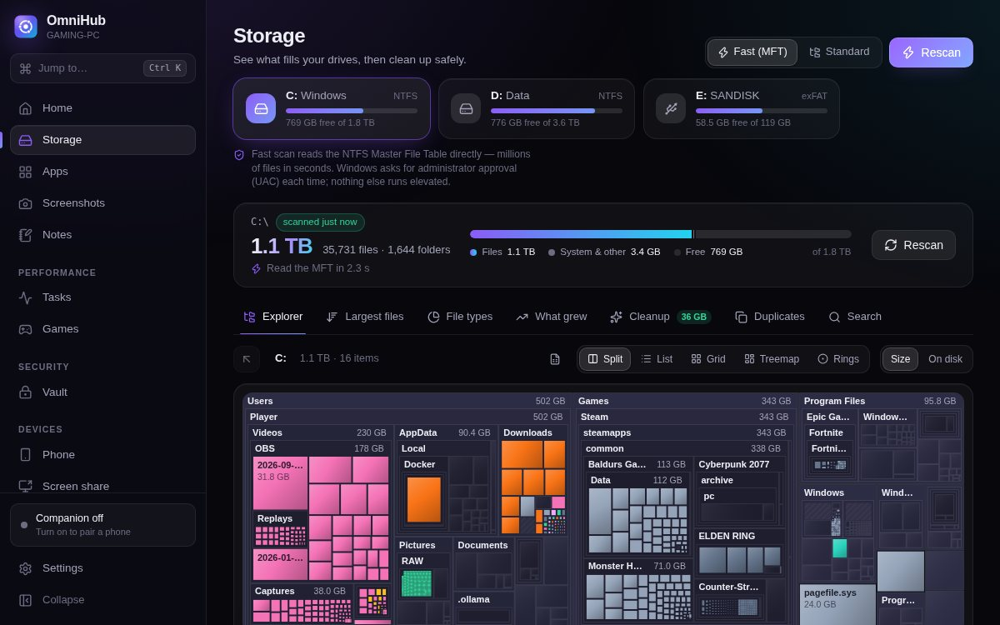 | 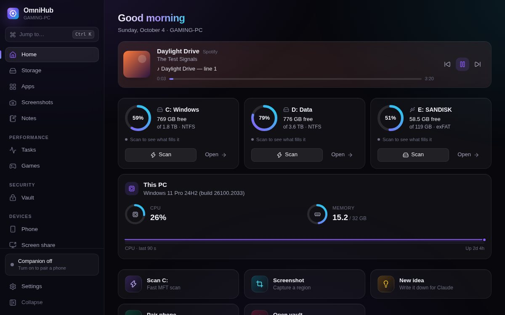 |
| 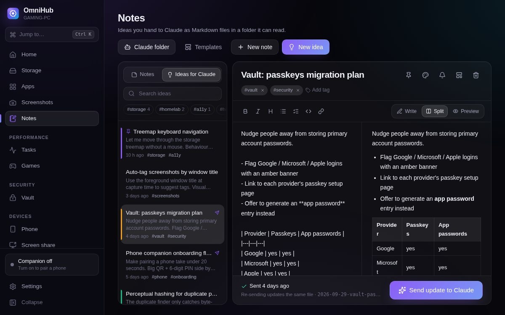 | 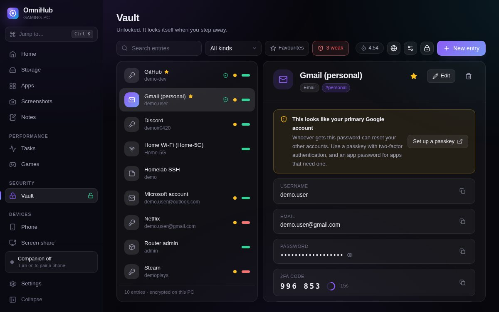 |
| 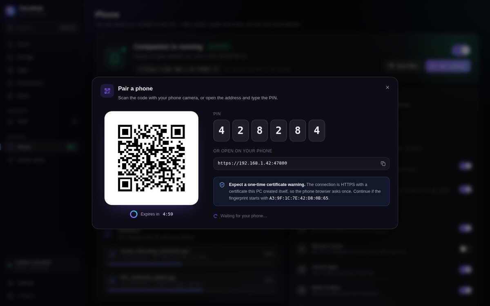 | 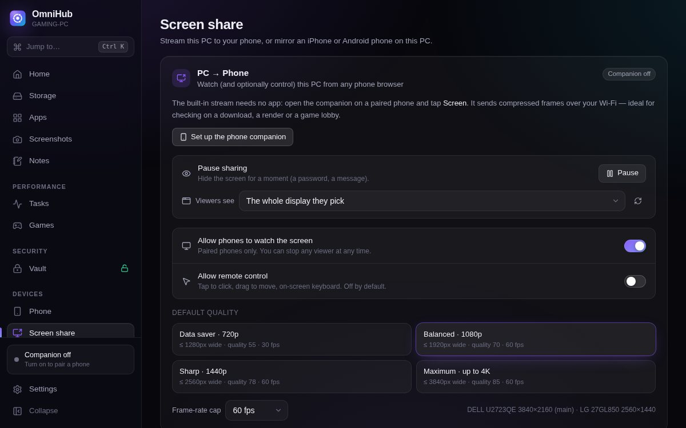 |
| 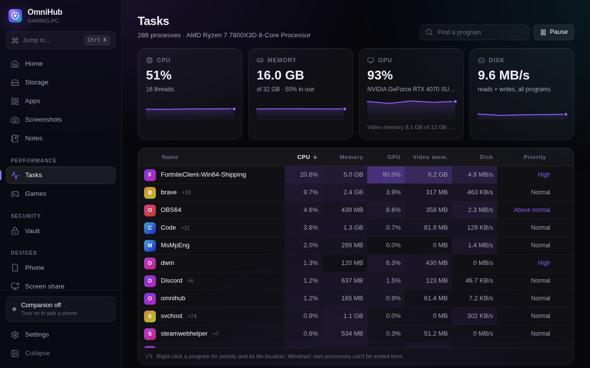 | 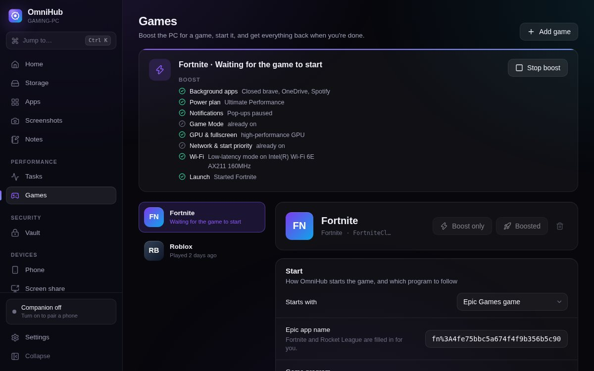 |

<p>
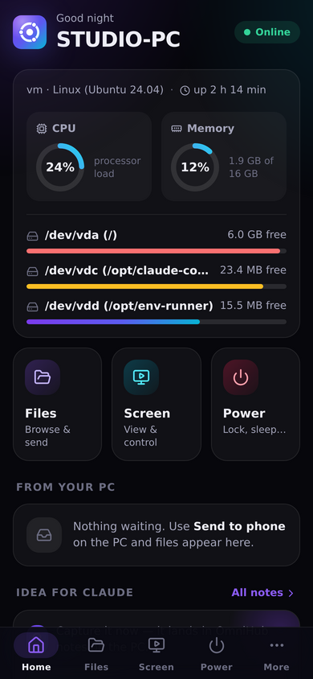
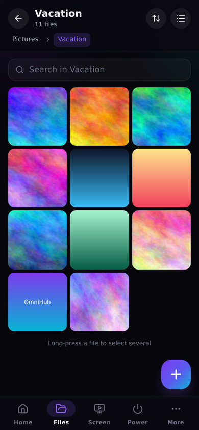
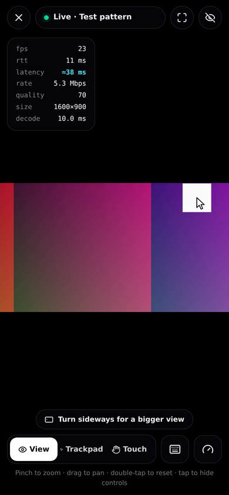
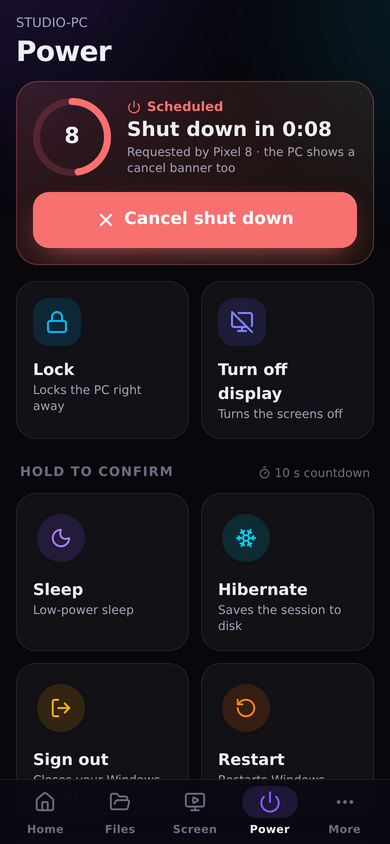
</p>
<p>
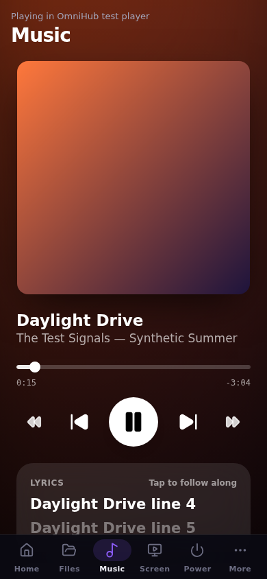
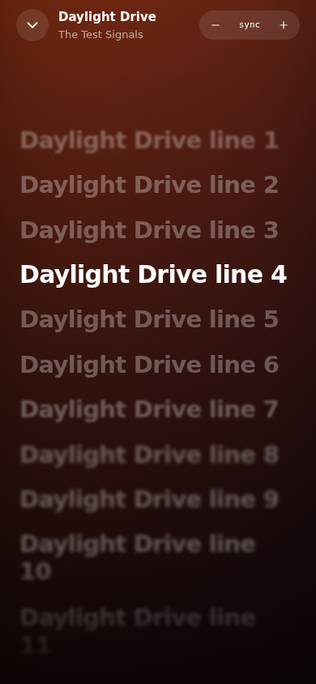
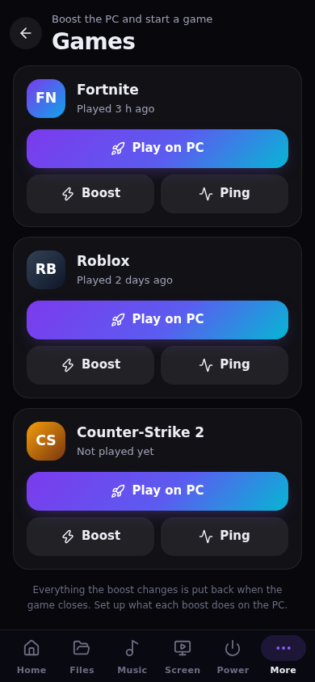
</p>

## How fast is the storage scan?

On a real Windows system drive with 1.15 million files and 212,000 folders
(GitHub's Windows runner), the MFT is read and parsed in **3.3 s** and the
browsable tree is built in **0.25 s**; refreshing it afterwards through the
USN change journal took **0.4 s**. (A folder walk has to ask the file system
about every directory and is typically many times slower.) The time grows with the number of files, not with drive
size, so a 4 TB drive full of large media files scans faster than a small
system drive. See [`docs/BENCHMARKS.md`](docs/BENCHMARKS.md).

## Decisions on the plan's open questions

1. **Phone platform** — Android first (best screen mirroring via scrcpy); the phone web app itself works the same on iOS.
2. **PWA for v1** — yes. The PC serves the app; add it to the home screen.
3. **Screen sharing** — both: a built-in stream that needs nothing installed, plus bridges to Sunshine/Moonlight (PC → phone, 4K60, hardware encode) and scrcpy (Android → PC). See [`docs/SCREEN_SHARE.md`](docs/SCREEN_SHARE.md).
4. **Claude ideas folder** — Markdown with YAML front matter by default; JSON sidecars and `INDEX.md` are options.
5. **Name** — OmniHub (working title kept).
6. **Network** — LAN only (private addresses; Tailscale's range can be allowed in settings). No cloud relay. The few internet requests are listed in [`docs/SECURITY.md`](docs/SECURITY.md#internet).

## Security in one paragraph

OmniHub runs as a normal user. Administrator rights are requested through UAC
only for the fast MFT scan, in a short-lived helper process. The phone server
is **off** until you turn it on, accepts only private-network addresses,
requires pairing (with the PC in front of you) and a per-device token, uses
HTTPS with a certificate generated on your PC, and logs power actions,
transfers, vault reveals and remote control in an audit log. Remote control
and phone vault access are separate opt-ins. Details:
[`docs/SECURITY.md`](docs/SECURITY.md).

## Install

1. Open [Releases](https://github.com/Kerioxsx/omnihub/releases/latest) and
   download `OmniHub_<version>_x64-setup.exe` (an `.msi` is there too).
2. Run it. It installs per user, so no administrator rights are needed.
   Windows 10/11; WebView2 is installed automatically if missing.
3. The installer is not code-signed yet, so SmartScreen warns: click
   **More info → Run anyway**.

Or build it yourself (below).

## Build

Requirements: Rust through rustup (the pinned version installs itself),
Node.js 22, and on Windows the MSVC build tools.

```sh
git clone https://github.com/Kerioxsx/omnihub && cd omnihub
npm ci
npm run build                 # desktop UI → dist/, phone app → dist-mobile/
npx tauri build               # Windows installer (NSIS + MSI)
```

Development:

```sh
npx tauri dev                 # desktop app with hot reload (Windows)
npm run dev                   # desktop UI in a browser with mock data (any OS)
cargo run -p omnihub-core --bin omnihub-headless -- --http --pair   # phone server only
npm run dev:mobile            # phone app with hot reload, proxied to that server
```

Tests:

```sh
cargo test -p omnihub-core                                  # unit + server end-to-end
sudo scripts/make-ntfs-fixtures.sh target/ntfs-fixtures     # Linux, needs ntfs-3g
OMNIHUB_NTFS_FIXTURES=$PWD/target/ntfs-fixtures cargo test -p omnihub-core --test ntfs_images
```

More in [`docs/DEVELOPMENT.md`](docs/DEVELOPMENT.md); the code layout is in
[`docs/ARCHITECTURE.md`](docs/ARCHITECTURE.md).

## Layout

```
omnihub/
├── crates/omnihub-core/   Rust: storage, vault, notes, apps, capture, music, tasks, games, phone server
├── browser-extension/     Brave/Chrome/Edge autofill extension (talks to the app over native messaging)
├── src-tauri/             Tauri shell: window, tray, hotkeys, region overlay, commands
├── src/desktop/           Desktop UI (React)
├── src/mobile/            Phone web app (React)
├── src/shared/            Types, formatting and design tokens shared by both UIs
├── mobile/                Phone app entry, manifest, service worker, icons
├── scripts/               NTFS fixture and benchmark image builders
└── docs/                  Plan, architecture, security, screen sharing, benchmarks
```

## License

MIT — see [LICENSE](LICENSE). It covers OmniHub, Vesper Client (`client/`) and OmniHub Kill Effects (`minecraft-mod/`); third-party fonts and the tools OmniHub downloads keep their own licenses.
