# OmniHub

A Windows companion for your PC: see what fills your drives in seconds, keep
notes and ideas for Claude, store passwords in a local encrypted vault (with
autofill in Brave, Chrome and Edge), boost the PC for games, mod your games,
host Minecraft servers around the clock, see what every program uses, and
use your phone to move files, control the music with synced lyrics, start a
game, run your servers or watch the PC's screen.

**[Download the latest release](https://github.com/Kerioxsx/omnihub/releases/latest)**
(Windows 10/11, 64-bit) · **[Website and tour](https://kerioxsx.github.io/omnihub/)**

Built from [`docs/PLAN.md`](docs/PLAN.md). Desktop app: Tauri 2 (Rust) +
React. Phone: a web app served by the PC itself — nothing to install from a
store, no cloud.

| | |
|---|---|
| **Storage** | Reads the NTFS Master File Table directly (the WizTree/Everything technique) and keeps it up to date from the USN change journal. Treemap, largest files, file types, search, cleanup suggestions, duplicates. Falls back to a parallel folder walk without admin rights or on FAT/exFAT/network drives. |
| **Apps** | Desktop programs, Store apps and Start menu entries with icons, size (from the latest scan), launch, uninstall, and the screenshots you took in each. |
| **Screenshots** | Region (frozen-screen overlay), screen, window, all screens; global hotkeys; a searchable library with tags, notes and favourites. Files stay normal PNG/JPEG files in *Pictures\OmniHub Screenshots*. |
| **Notes & ideas** | Markdown notes. "Ideas for Claude" are written as `.md` files (YAML front matter, optional JSON sidecar, an `INDEX.md`) into a folder you choose; the folder is watched so replies Claude writes there show up. |
| **Chats** | Talk to **Claude** and **ChatGPT's models** with your own API keys, and pick up your **Claude Code** and **Codex** conversations on this PC: read them, keep texting them (they run in their project folder with the permission mode you pick), or start new ones — from the PC or **from your phone**. Save any message as an **idea**, and see your **usage**: Claude Code's 5-hour window and tokens (with what they'd cost on the API), Codex's plan limits, and what your API keys spent. |
| **Vault** | Passwords, logins, Wi-Fi keys and secure notes, encrypted with Argon2id + AES-256-GCM and bound to your Windows account with DPAPI. Auto-lock, lock with Windows, Windows Hello unlock, clipboard that clears itself and stays out of clipboard history. Two-factor codes (TOTP), a password health report with an optional breach check, and **autofill in Brave, Chrome and Edge** through a small extension that talks only to the app on your PC. |
| **Tasks** | CPU, memory, **GPU**, video memory and disk use of every program, live, like Task Manager — with End task, priority and file location. Also on the phone. |
| **Games** | A boost profile per game (Fortnite, Roblox, VALORANT, CS2, Apex, Overwatch 2, Rocket League, League, GTA V, Call of Duty, Minecraft, Cyberpunk 2077 or any program), found on your PC from Epic, Steam, Riot, Roblox and Minecraft, in **Competitive**, **Quality** (never touches the game's graphics) or **Custom** mode: power plan, background junk closed, background apps at lower priority, a 0.5 ms timer, notifications, GPU choice, game priority, Wi-Fi low-latency mode and network priority — applied when you press Play and put back when the game closes. Max-FPS settings for seven games, the game's **NVIDIA driver profile**, an **FPS meter** (PresentMon: live FPS, 1% lows, stutters — also on the phone), **Optimize PC**, a ping helper with a lag-under-load test, and Roblox Fast Flag presets. |
| **My PC** | Your PC in 3D, built from its detected parts (processor, graphics card, memory sticks, motherboard, cooler, hubs) and your description of the case. **Lighting** for everything OpenRGB knows (static, breathing, spectrum, wave, flow, music, temperature; your own profiles), **fan profiles** Silent, Default (Auto) and Fast through LibreHardwareMonitor and liquidctl with safety floors, and **screens**: a case screen or a Kraken LCD showing your picture, GIF, video, live stats or the song. |
| **Mods** | A **mod manager** for every game in the Steam library (and Epic, and any game folder): how each game is modded (BepInEx, MelonLoader, Lovely + Steamodded, Script Hook V, .pak/UE4SS…), **Thunderstore** search and one-click installs with dependencies and the loader, mods from a file (zip, 7z, folder), on/off/update/remove with the game's files backed up, Steam Workshop items. **Minecraft modpack mixing** (Modrinth packs, .mrpack files or installed instances → one pack for one version and loader, saved as .mrpack or installed in the Minecraft Launcher), with a cover blended from the packs' icons, or painted from them by Pollinations with your own account. **Claude makes mods** with your Anthropic API key: it reads the game, writes the mod, and you install it with one click. |
| **Servers** | **Minecraft servers hosted on this PC, 24/7**: vanilla, Paper, Fabric, Quilt, Forge or NeoForge, made in one go (the right Java included), from a Modrinth modpack or one of your mixes (only the mods a server needs), started with OmniHub, restarted if they crash, backed up on a schedule. **Players** (whitelist, operators, bans, where each one is, their inventory: give, take away, teleport, heal), a **live map** drawn from the world's own files, the player limit and every setting, **mods, plugins and data packs** from Modrinth, **Claude making data packs and Paper plugins**, a console, and the way in for friends (firewall, router port, public address). **Who can join**: paid Minecraft accounts only, or **everyone, also without a paid account**, with your operators guarded. All of it from your phone too. |
| **Lights** | Every **Govee** light on the network (LAN Control), live: power, brightness, colours and whites, **screen sync** (each light takes its colours from its place around the screen, up to 30 times a second, eased), **music sync** (the album cover's colours, pulsing on the beats, spectrum or flow), effects, presets, timers and a sleep timer. With a Govee API key: each light's own scenes, music modes and settings (gradient, night light, a speaker's volume where it has one). |
| **Music** | What the PC plays (Spotify, Apple Music, browsers…). **Aurora**: the song's official music video (up to 4K, in step) or its full-size cover behind short lyrics in the cover's colours with sparing 3D emojis, or a music-reactive light show, a neon edge light, and lyrics word by word — full screen, on the Music page, or as a glow around your monitor over every app. Or the Apple Music–style **Lyrics** view. On your phone: cover, play/pause/skip/seek, volume, bass and treble (with Equalizer APO), and time-synced lyrics. |
| **Phone** | Pair by QR code or PIN. Volume of each app, mute the microphone and control calls (Discord, WhatsApp, Nyxen…), close or quit open apps. Browse shared folders, download with resume, upload big files with resume and checksums, receive files from the PC, lock/sleep/restart/shut down with a cancellable countdown, music with lyrics, tasks, start games with their boost, launch apps, jot ideas, read the vault (opt-in, HTTPS only), text Claude, ChatGPT, Claude Code and Codex, and run your Minecraft servers (players, inventories, the map, console). |
| **Screen sharing** | PC → phone in any browser (desktop duplication, adaptive JPEG stream, optional mouse/keyboard control, pause or share one window for privacy). For 4K60 it hands off to Sunshine + Moonlight; Android → PC uses scrcpy, and **iPhone → PC** uses AirPlay (a UxPlay add-on OmniHub downloads and checks for you). |

## New in 0.15.1

- **Roblox starts again**: Roblox now blocks shader tools, so OmniHub takes out the ReShade 0.15.0 put in its folder and no longer installs it. **No duplicate games** under *On this PC*.

## New in 0.15.0

- **A much lighter app**: windows you can't see (in the tray, minimised, or behind a full-screen game) stop drawing, give back their memory and sleep until you look again; pages load only when opened; "is it running?" checks no longer take a full process sample.
- **Games open again**: Roblox opens its app from Play, a slow game gets a hint and a **Start again** button, and a new **Free memory before the game** step gives the game the most free RAM.
- **Fortnite**: a one-click **Max FPS setup**, a **Rendering mode** choice (Performance, DirectX 12, DirectX 11 or keep yours) and **Clean Fortnite caches** (logs, crash reports, web cache and the graphics driver's shader caches). Plus everything from 0.14.0 below.

## New in 0.14.0

- **Roblox shaders** like RoShade and Bloxshade (official ReShade with Realistic, Vivid, Cinematic, Soft, Sharp and Custom looks, kept after Roblox updates), **every Roblox flag** searchable with each custom flag switched on or off, and Govee lights with segments (like the H6076) in full colour on Auto.

## New in 0.13.5

- **Govee**: *Per segment, any light* gives lights that ignore streaming (like the H6076 floor lamp) a colour per segment through Govee's own segment commands.

## New in 0.13.4

- **Govee**: lights that don't stream segments (like the H6076 floor lamp) get one colour in effects, music and screen, a calmer brightness boost, and SteelSeries GG (Prism) is spotted when it fights over the keyboard. Mixes have a **Save as .mrpack** button again.

## New in 0.13.3

- **NeoForge and Forge mixes install** straight into the Minecraft Launcher (OmniHub runs their installer). **Govee**: steadier lamps, more saturated colours, each light shows what it gets. **PC lighting**: *Like the Govee lights* for the keyboard and PC, a warning when another RGB program fights over the lights, and no more keyboard lag.

## New in 0.13.2

- **Govee lights**: lights with few LEDs show the screen's main colour instead of a pale white, Auto gives one colour to every light not known to stream segments (so every light updates), and a light that drops out of streaming comes back by itself.

## New in 0.13.1

- **Govee lights**: every light found (OmniHub also asks each address on the network), **Auto** per-segment or one-colour streaming so every light follows music and the screen, a **brightness boost** and truer screen colours, and smoother music on lamps with many LEDs. Installer fix for a remembered install folder on a drive that's gone.

## New in 0.13.0

- **Share mixes and modpacks with friends**: one file with every mod, the configs and the cover picture, optionally with your server in their list; open a friend's pack and it becomes a mix with their picture, ready to install. Modpack details (mods, updates on Modrinth, worlds), and **a server from a world you played alone**, with your single-player inventory moved to your account.

## New in 0.12.1

- **Your installed modpacks**: Mods → Minecraft lists the modpacks Prism Launcher (and PolyMC, MultiMC), CurseForge and the Modrinth App installed, with their version, loader, mods and when you last played. Mix any of them with other packs, or host one as a server in one click. Folders are only read; a launcher kept on another drive can be added.

## New in 0.12.0

- **Minecraft server hosting** (a new Servers tab): make a vanilla, Paper, Fabric, Quilt, Forge or NeoForge server, or one from a modpack or your mix, and keep it running 24/7 on this PC. Players with their location and inventory, the whitelist, the player limit, a live map, mods, plugins and data packs (also made by Claude), backups, and friends joining over the internet. **Players without a paid Minecraft account can join** if you choose: OmniHub then keeps your operators safe (an operator's name from a new place waits for your OK). Everything also works from the phone (More → Minecraft servers).

## New in 0.11.1

- **Covers for mixed Minecraft modpacks**: each mix gets a picture made from its packs' icons (every icon whole, on soft seams, pixel art kept crisp), used as its Minecraft Launcher profile icon. Or **AI blend**: Pollinations paints one new picture from them, with your own Pollinations account.

## New in 0.11.0

- **Chats**: Claude, ChatGPT, Claude Code and Codex in one place, also from your phone (a new Chats tab): every conversation on your PC, streamed answers, new chats in any project folder, ideas saved from any message, and usage (Claude Code's 5-hour window and tokens, Codex's plan limits, your API keys' spend).

## New in 0.10.0

- **Mods**: a mod manager for every game in your library (Thunderstore installs with dependencies and loaders, mods from files, on/off/update/remove with backups, Steam Workshop), a **Minecraft modpack mixer**, and **Claude making mods** for your games with your own Anthropic API key.

## New in 0.9.0

- **Lights**: every Govee light on your network, with **screen sync**, **music sync** (album cover colours and beats), effects, presets, timers and a sleep timer; with a Govee API key also each light's own scenes, music modes and settings, including a speaker's volume where a light has one.

## New in 0.8.1

- **More for Fortnite**: NVIDIA Reflex On + Boost, GPU crash debugging and latency markers off, and with Lowest quality also Nanite, Lumen and temporal anti-aliasing off (for DirectX 12).
- **More for Roblox**: the graphics slider at its lowest instead of Automatic, and *Lighting worked out once* (an allowlisted Fast Flag) in the Max FPS preset.
- **Memory speed check** in Optimize PC: says when a DDR5-6000 or DDR4-3600 kit runs slower because EXPO or XMP is off in the BIOS.

## New in 0.8.0

- **Play and Boost only work again**: the administrator prompt opens in front and the game never waits behind it.
- **My PC**: your PC in 3D from its detected parts, with **lighting** (OpenRGB: effects, music sync, profiles), **fan profiles** Silent / Default (Auto) / Fast (LibreHardwareMonitor, liquidctl) and **screens** (a case screen or a Kraken LCD with your picture, GIF, video, stats or song).
- **Fortnite and Competitive mode** also set the game's **NVIDIA driver profile** (maximum performance, low latency, no forced VSync or frame cap).
- **Lighter in the tray**: the web view drops caches, timers pause, and the music check slows down when nothing plays.

## New in 0.7.3

- **Music videos matched to the song by ear** (a story intro is skipped), **Spotify's Canvas and videos mirrored** from its window, glitch and echo on the sung word, colour flashes on drops, lyrics in time with the voice, and no more getting stuck in full screen.

## New in 0.7.2

- **Any emoji pack** in Aurora: a zip of pictures (PNG, GIF, WebP, JPG or SVG — Twemoji, Noto, OpenMoji, Discord emotes, game textures…) matched by code point, name, short code or the word itself, or an emoji font. Pixel art stays crisp. Your files stay on your PC.

## New in 0.7.1

- **Your own font and emoji pictures** in Aurora: choose a font file and a zip of item textures (a Minecraft look); words get the matching picture. They stay on your PC.
- **An emoji at least every two lines**, the **whole cover** again for everyone, clearer reasons when a **music video** can't play, and **faster releases**.

## New in 0.7.0

- **Music videos play**: through a relay page on OmniHub's website (YouTube refuses official videos inside apps), and directly with yt-dlp when an artist allows their video only on YouTube; the most watched official video wins.
- **Animated album covers** from Apple Music (up to 4K) behind the lyrics, and under the light show's effects.
- **The whole cover**, nothing cut off, sides blending into its own glow; remixes get their own cover; Deezer as a second cover source.
- **Lyrics for more songs**: NetEase as a second synced source; misses are retried.
- **Emojis in Spanish too**, more often, plain and in the lyrics' colour by default.
- **Simpler Aurora settings**: Quick choices first, the rest under More settings.

## New in 0.6.1

- **Smoother lyrics in Aurora**: sung words now fade and leave on their own (at most three at a time) instead of collecting, invisible, for a whole line — less work for the graphics card and no words piling up on slower PCs.

## New in 0.6.0

- **Aurora goes cinema**: the song's **official music video** fills the screen behind the lyrics (muted, up to 4K, kept in step with the song); else the artist's **animated cover**; else the **whole cover at full size** (the 3000×3000 original from Apple's catalogue, sharp on any monitor) drifting slowly; else the light show.
- **Short lyrics in the cover's colours**, with adaptive shadow and darkening so they stay readable on bright pictures, placed where the cover is calm.
- **3D emojis** (Microsoft Fluent Emoji) beside words you can picture or feel — sparingly, never on every line.
- **Corner light** in the cover's colours, and a *Background* section for all of it: what plays, music videos on/off, fill or whole picture, crop, video quality, cover motion, darkening, corner light, video timing.

## New in 0.5.1

- **Sharper covers**: the same cover at 1200×1200 from Apple's iTunes catalogue when it matches (players give Windows a small one), and crisp bicubic scaling for the rest.
- **14 effects** for the cover, each with its own slider (beat zoom, glow, echo, ripples, twist, shake, glitch, colour split, pixelate, fisheye, kaleidoscope, halftone, scanlines, duotone), with Calm, Default, Wild and Shuffle presets; glitch is now subtle by default.
- **Lyrics word by word for every song**: when the lyrics only time lines, the words are spread over each line by syllables (an estimate; can be turned off). Only the word being sung is highlighted.
- **Lyrics that move** with the music — bounce on beats, sway, pop in — with a Movement slider.

## New in 0.5.0

- **Aurora**, a new music view (the Apple Music–style **Lyrics** view stays; switch at the top left or with V):
  - the playing song's **cover art** as the visual, on black: it swells with the bass, glitches and splits on beats, with Visual, Fisheye, Fisheye Visual, Minimal and Ambient styles;
  - a thin **neon edge light** (edge, inner highlight, glow and bloom) in the cover's colours, pulsing with the music;
  - **lyrics, huge and floating**: one word at a time when the lyrics time words, else one line, with the next in a pill; instrumental breaks, songs without lyrics and instrumentals each handled;
  - follows the music through **WASAPI loopback** (what Windows plays — never the microphone, nothing recorded or sent), with sensitivity, bass, smoothing, reduced motion and no-flash settings;
  - a glass **settings panel** for every part, saved and with Reset to defaults;
  - optional **glow around your screen** over every app (each monitor or one), click-through, stepping aside for full-screen games.
- **Your own .lrc files** for lyrics (checked before LRCLIB, matched by tags or name and length).

## New in 0.4.0

- **Boost modes**: Competitive (most FPS, also the game's own graphics), Quality (nothing that changes the picture — 4K Ultra stays 4K Ultra) or Custom, per game.
- **Max-FPS settings for VALORANT, Counter-Strike 2, Apex Legends, Overwatch 2 and Roblox**, next to Fortnite and Minecraft, with **Optimize all** in Optimize PC.
- **Less delay while playing**: background junk closed (and sync apps reopened), browsers and launchers at lower priority, a 0.5 ms timer, no power throttling for the game.
- **FPS meter** with live FPS, 1% lows and stutters, on the PC and the phone, and results to compare boosts.
- **Lag under load** test with a grade and advice; a precise timer, no network throttling and no Sticky Keys pop-up in Optimize PC.

## New in 0.3.0

- **Fortnite at max FPS**: unlimited frame rate, Performance mode, lowest settings, VSync off and the FPS counter, written into Fortnite's own settings (yours kept to put back), before every launch.
- **Optimize PC**: full monitor refresh rate, Ultimate Performance, no Game DVR, Game Mode, windowed-game optimizations, GPU scheduling, no mouse acceleration — checked, one click each, undoable.
- **Finds your games** from Epic, Steam, Riot, Roblox and Minecraft, and a Minecraft optimizer.
- **Full-screen lyrics** on the PC, Apple Music style, and a Music page.

## New in 0.2.6

- No more "Error writing to file … omnihub.exe" when installing: the installers close every running OmniHub first (also the browser extension's hidden helper, which now runs from a copy in the data folder), and OmniHub closes when Windows or an installer asks.

## New in 0.2.5

- The setup and automatic updates work when OmniHub is in Program Files: they ask for administrator approval instead of failing with "Error writing to file" (automatic updates wait for your click there).

## New in 0.2.4

- The AirPlay receiver uses the video and sound outputs it is tested with. It says how it ended if it closes, and offers a safe mode (software video).
- Automatic updates wait until OmniHub is in the tray and say "Updated to …" afterwards.
- After an unexpected close, the next start offers "Copy details" (OmniHub's log plus Windows' crash summaries), and a page error no longer blanks the window.

## New in 0.2.3

- iPhone → PC mirroring announces the PC's Wi-Fi address (it could pick a VPN or virtual adapter before) and checks that iPhones can find it.
- Calls are only calling apps recording from the microphone right now — no more "in a call" for a game's voice chat or a call that already ended.
- The phone's screen viewer covers the whole screen and has a working full-screen button on iPhone.

## New in 0.2.2

- **Volume & calls** on the phone: each app's volume and mute, the PC's volume, mute the microphone in every app, and Mute mic / Deafen for a call in Discord, WhatsApp, Nyxen, Teams or a browser.
- **Open apps** on the phone: close any program (like clicking ×) or quit it.
- **Music in landscape**, and play/pause, skip and volume in the full-screen lyrics.

## New in 0.2.1

- Phones on Wi-Fi could not reach the PC on Windows ("site can't be reached"): fixed, plus a self-test in Phone → Connection check.
- **Updates install from inside the app** (Settings → About), automatically by default.
- **Approve fast scans once** instead of a Windows prompt every time (Settings → Storage).

## New in 0.2.0

- **Games** page: boost profiles, Play/Boost from the PC or the phone, ping helper, Roblox Fast Flags.
- **Tasks** page: per-program CPU, memory, GPU, video memory and disk; priority and End task; on the phone too.
- **Music** on the phone: synced lyrics, cover art, controls, volume, bass/treble.
- **Browser autofill** for the vault (Brave, Chrome, Edge), TOTP codes, password health.
- **iPhone mirroring** to the PC over AirPlay; screen-share privacy (pause, one window).
- PC → phone sending, storage view modes, storage growth report, startup apps, screenshot markup and text recognition, note reminders and templates, settings backup — and the greeting uses *your* name (from Windows, or Settings → General → Your name).

## Screenshots

The desktop app (shown with its built-in demo data) and the phone app (talking to a real OmniHub server):

| | |
|---|---|
| 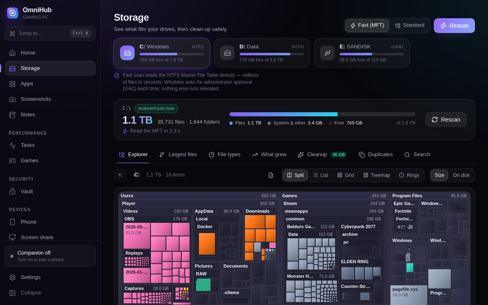 | 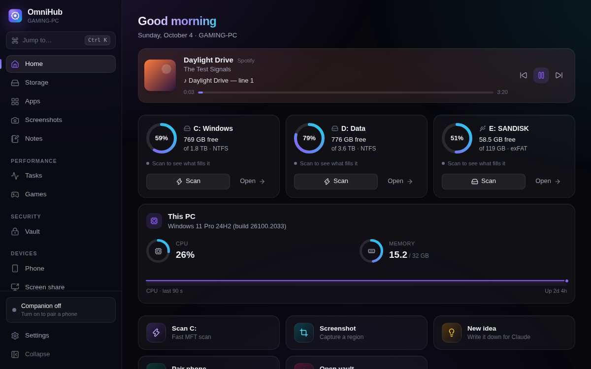 |
| 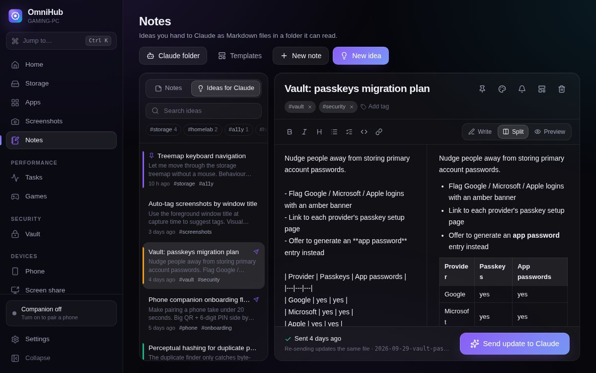 | 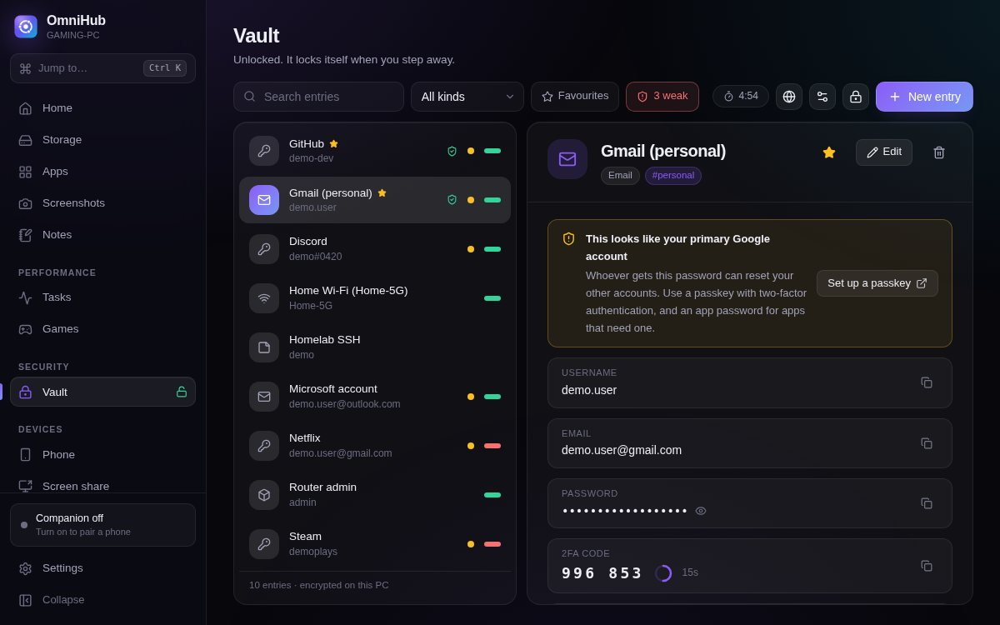 |
| 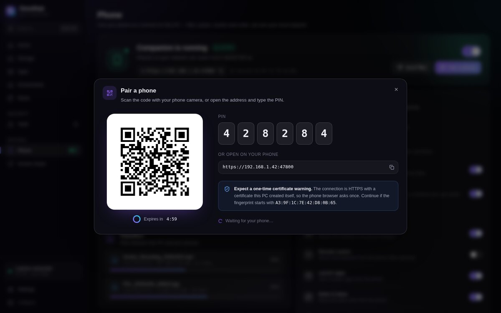 | 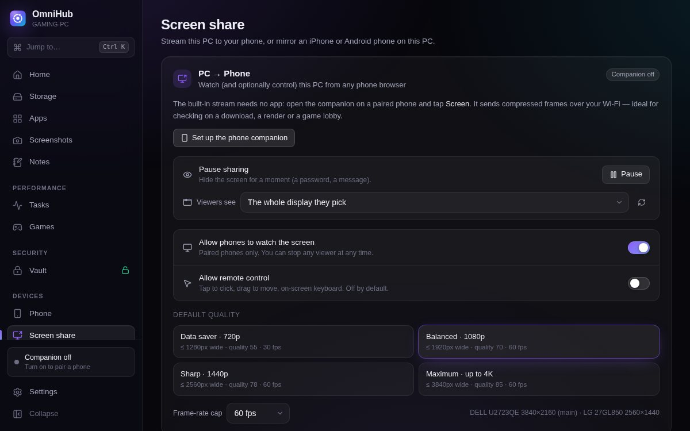 |
| 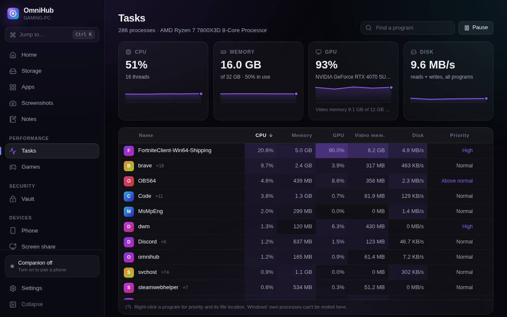 | 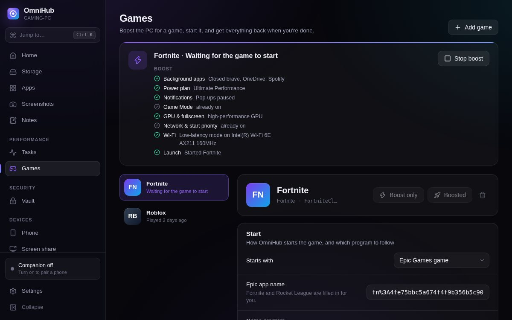 |

<p>
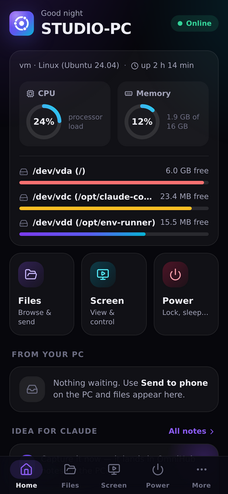
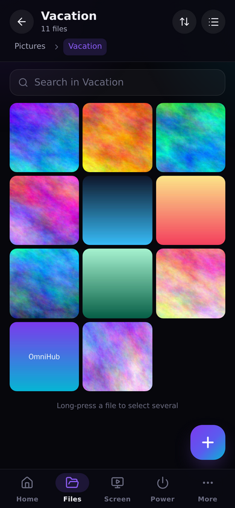
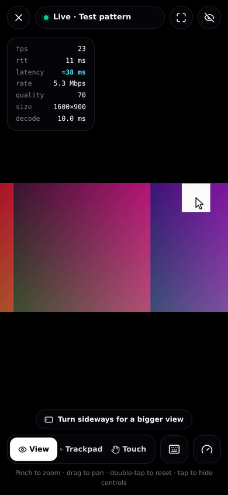
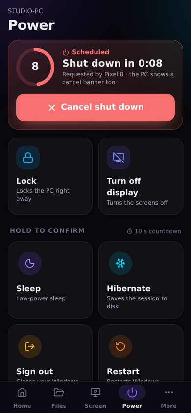
</p>
<p>
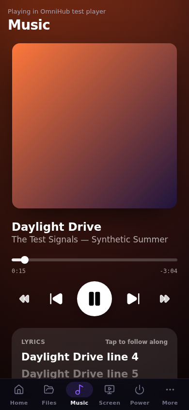
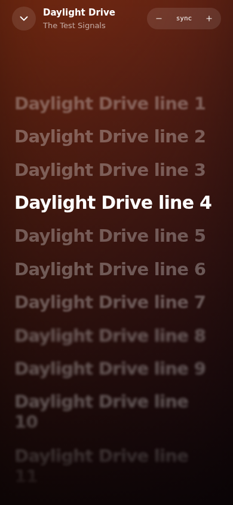
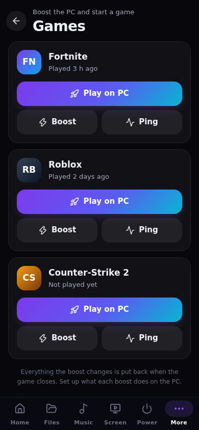
</p>

## How fast is the storage scan?

On a real Windows system drive with 1.15 million files and 212,000 folders
(GitHub's Windows runner), the MFT is read and parsed in **3.3 s** and the
browsable tree is built in **0.25 s**; refreshing it afterwards through the
USN change journal took **0.4 s**. (A folder walk has to ask the file system
about every directory and is typically many times slower.) The time grows with the number of files, not with drive
size, so a 4 TB drive full of large media files scans faster than a small
system drive. See [`docs/BENCHMARKS.md`](docs/BENCHMARKS.md).

## Decisions on the plan's open questions

1. **Phone platform** — Android first (best screen mirroring via scrcpy); the phone web app itself works the same on iOS.
2. **PWA for v1** — yes. The PC serves the app; add it to the home screen.
3. **Screen sharing** — both: a built-in stream that needs nothing installed, plus bridges to Sunshine/Moonlight (PC → phone, 4K60, hardware encode) and scrcpy (Android → PC). See [`docs/SCREEN_SHARE.md`](docs/SCREEN_SHARE.md).
4. **Claude ideas folder** — Markdown with YAML front matter by default; JSON sidecars and `INDEX.md` are options.
5. **Name** — OmniHub (working title kept).
6. **Network** — LAN only (private addresses; Tailscale's range can be allowed in settings). No cloud relay. The few internet requests are listed in [`docs/SECURITY.md`](docs/SECURITY.md#internet).

## Security in one paragraph

OmniHub runs as a normal user. Administrator rights are requested through UAC
only for the fast MFT scan, in a short-lived helper process. The phone server
is **off** until you turn it on, accepts only private-network addresses,
requires pairing (with the PC in front of you) and a per-device token, uses
HTTPS with a certificate generated on your PC, and logs power actions,
transfers, vault reveals and remote control in an audit log. Remote control
and phone vault access are separate opt-ins. Details:
[`docs/SECURITY.md`](docs/SECURITY.md).

## Install

1. Open [Releases](https://github.com/Kerioxsx/omnihub/releases/latest) and
   download `OmniHub_<version>_x64-setup.exe` (an `.msi` is there too).
2. Run it. It installs per user, so no administrator rights are needed.
   Windows 10/11; WebView2 is installed automatically if missing.
3. The installer is not code-signed yet, so SmartScreen warns: click
   **More info → Run anyway**.

Or build it yourself (below).

## Build

Requirements: Rust through rustup (the pinned version installs itself),
Node.js 22, and on Windows the MSVC build tools.

```sh
git clone https://github.com/Kerioxsx/omnihub && cd omnihub
npm ci
npm run build                 # desktop UI → dist/, phone app → dist-mobile/
npx tauri build               # Windows installer (NSIS + MSI)
```

Development:

```sh
npx tauri dev                 # desktop app with hot reload (Windows)
npm run dev                   # desktop UI in a browser with mock data (any OS)
cargo run -p omnihub-core --bin omnihub-headless -- --http --pair   # phone server only
npm run dev:mobile            # phone app with hot reload, proxied to that server
```

Tests:

```sh
cargo test -p omnihub-core                                  # unit + server end-to-end
sudo scripts/make-ntfs-fixtures.sh target/ntfs-fixtures     # Linux, needs ntfs-3g
OMNIHUB_NTFS_FIXTURES=$PWD/target/ntfs-fixtures cargo test -p omnihub-core --test ntfs_images
```

More in [`docs/DEVELOPMENT.md`](docs/DEVELOPMENT.md); the code layout is in
[`docs/ARCHITECTURE.md`](docs/ARCHITECTURE.md).

## Layout

```
omnihub/
├── crates/omnihub-core/   Rust: storage, vault, notes, apps, capture, music, tasks, games, phone server
├── browser-extension/     Brave/Chrome/Edge autofill extension (talks to the app over native messaging)
├── src-tauri/             Tauri shell: window, tray, hotkeys, region overlay, commands
├── src/desktop/           Desktop UI (React)
├── src/mobile/            Phone web app (React)
├── src/shared/            Types, formatting and design tokens shared by both UIs
├── mobile/                Phone app entry, manifest, service worker, icons
├── scripts/               NTFS fixture and benchmark image builders
└── docs/                  Plan, architecture, security, screen sharing, benchmarks
```
